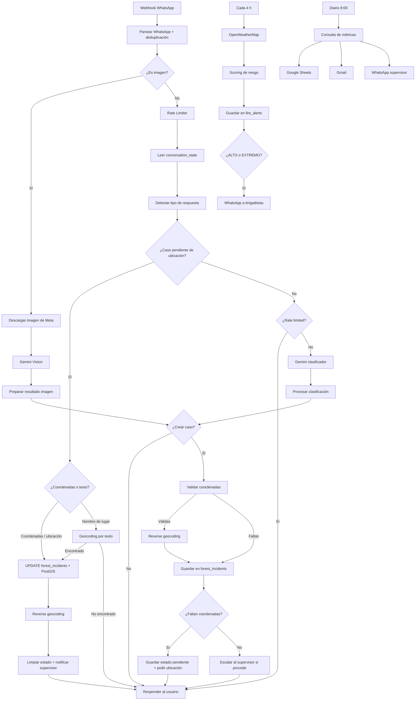
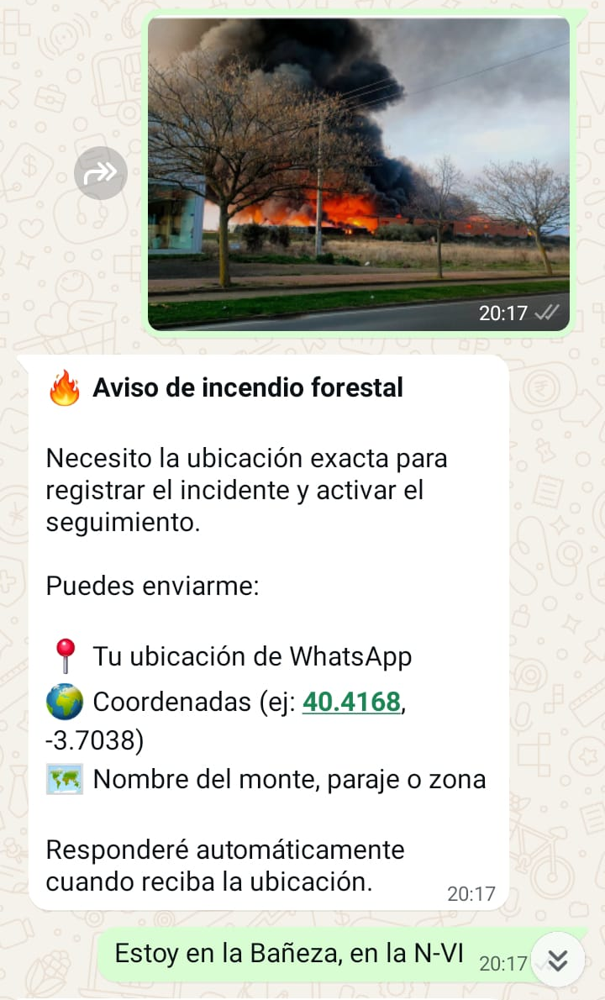
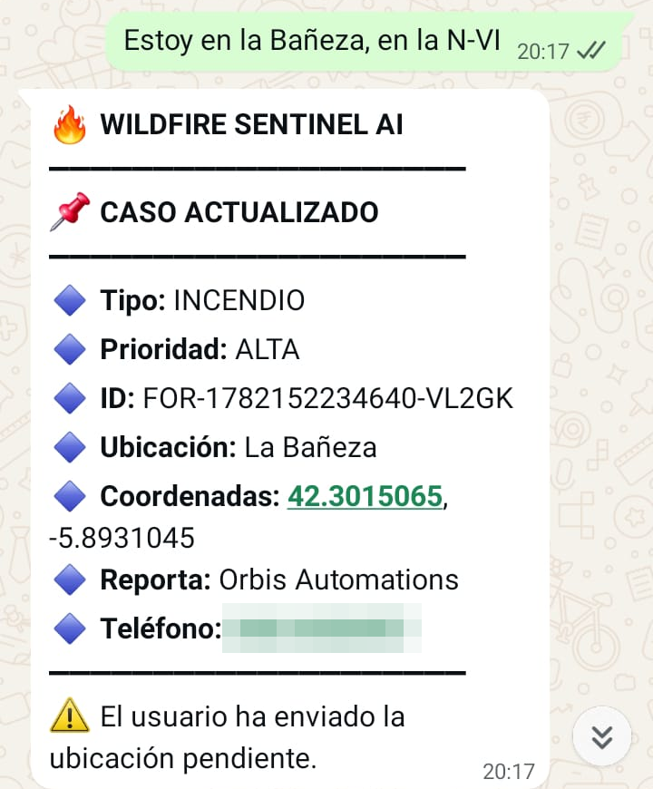

# 🔥 Wildfire Sentinel AI

🇬🇧 [English version](README.md)

**Wildfire Sentinel AI** es un sistema multimodal de avisos y alertas de incendios forestales construido con **n8n**, **WhatsApp Business API**, **Gemini AI** (texto y visión), **PostgreSQL/PostGIS**, **Google Maps Geocoding**, **OpenWeatherMap**, **Google Sheets** y **Gmail**.

Cualquier persona puede avisar de humo o fuego por WhatsApp, con texto, una foto o su ubicación. El sistema clasifica el aviso con IA, pide la ubicación si falta, registra el caso con geolocalización y escala al supervisor los casos críticos. Además, calcula el riesgo meteorológico de incendio de forma periódica y envía un resumen diario de métricas.

[](https://n8n.io/)
[](https://ai.google.dev)
[](https://developers.facebook.com/docs/whatsapp)
[](https://www.postgresql.org/)
[](https://postgis.net/)
[](https://mapsplatform.google.com/)
[](https://openweathermap.org/api)
[](LICENSE)
[](https://github.com/alejandro-orbis)

---

## 🚀 Funcionalidades principales

- 📲 Recepción de avisos por WhatsApp: texto, imagen, ubicación nativa, documentos y botones interactivos
- 🤖 Clasificación de avisos con Gemini (`INCENDIO` / `OTRO`), con subtipo y prioridad
- 🖼️ Análisis de imágenes con Gemini Vision: detecta humo, fuego, tamaño estimado y viviendas o carreteras cercanas
- 📍 Flujo conversacional de ubicación pendiente: si falta la ubicación, el bot la pide y completa el caso cuando llega
- 🗺️ Tres formas de dar la ubicación: ubicación de WhatsApp, coordenadas escritas o nombre del lugar (geocoding por texto)
- 🧭 Reverse geocoding a municipio, provincia y dirección aproximada
- 🗄️ Registro geoespacial en PostgreSQL + PostGIS (`POINT`, SRID 4326)
- 🚨 Escalado automático al supervisor por WhatsApp según tipo y prioridad
- 🌦️ Cálculo de riesgo de incendio cada 4 horas y alertas a brigadistas
- 📊 Resumen diario de métricas por WhatsApp, email y Google Sheets
- 🛡️ Rate limiting por conversación y deduplicación de mensajes de WhatsApp

---

## 🧩 Workflows

| Workflow | Disparador | Propósito |
|---|---|---|
| `01 Core (WhatsApp)` | Webhook de WhatsApp | Recepción, clasificación, geolocalización, registro y escalado de avisos |
| `02 Alertas (Clima)` | Cada 4 horas | Scoring de riesgo meteorológico, registro y alerta a brigadistas |
| `03 Dashboard (Métricas)` | Cada día a las 8:00 | Métricas de los últimos 7 días a Google Sheets, Gmail y WhatsApp |

---

## 🏗️ Arquitectura



---

## 🧠 Clasificación con IA

### Texto

Gemini clasifica cada mensaje y devuelve un JSON con tipo, subtipo, prioridad, descripción, coordenadas, ubicación en texto y si requiere escalado.

| Campo | Valores |
|---|---|
| `tipo` | `INCENDIO`, `OTRO` |
| `subtipo` | `HUMO`, `FUEGO`, `RAYO`, `COLILLA`, `QUEMA_ILEGAL`, `BARBACOA`, `MAQUINARIA`, `LINEA_ELECTRICA`, `FOCO_TERMICO`, `OTRO_RIESGO` |
| `prioridad` | `ALTA`, `MEDIA`, `BAJA` |

Hay salvaguardas fuera de la IA: los saludos y mensajes casuales nunca crean caso, y unas coordenadas sueltas sin aviso pendiente tampoco.

### Imagen

Las fotos se descargan de la API de Meta y se envían a Gemini Vision, que estima si hay humo o fuego, el tamaño del incendio y si hay viviendas o carreteras cerca. La prioridad pasa a `ALTA` si hay fuego visible, viviendas cerca o un incendio grande.

### Escalado al supervisor

Se notifica al supervisor cuando el caso es un `INCENDIO` con prioridad distinta de `BAJA`, o cuando la prioridad es `ALTA`. También se le avisa cuando un caso pendiente recibe su ubicación.

---

## 🌦️ Scoring de riesgo meteorológico

El workflow de alertas consulta OpenWeatherMap cada 4 horas y suma puntos según tres factores:

| Factor | Umbral | Puntos |
|---|---|---|
| Temperatura | > 25 / > 30 / > 35 °C | 15 / 30 / 40 |
| Humedad | < 40 / < 30 / < 20 % | 15 / 30 / 40 |
| Viento | > 20 / > 30 / > 50 km/h | 10 / 20 / 30 |

| Puntuación | Nivel |
|---|---|
| ≥ 70 | `EXTREMO` |
| ≥ 50 | `ALTO` |
| ≥ 30 | `MODERADO` |
| < 30 | `BAJO` |

Todas las lecturas se guardan en `fire_alerts`. Con nivel `ALTO` o `EXTREMO` se envía una alerta por WhatsApp a cada brigadista configurado.

> La zona monitorizada se define con las coordenadas del nodo **Consultar OpenWeatherMap**. Cámbialas por las de tu zona.

---

## 🛠️ Stack tecnológico

| Tecnología | Uso |
|---|---|
| n8n | Orquestación de workflows |
| Gemini 2.5 Flash Lite | Clasificación de texto y análisis de imágenes |
| WhatsApp Business API (Meta Graph v19.0) | Entrada de avisos y notificaciones |
| PostgreSQL + PostGIS | Persistencia y datos geoespaciales |
| Google Maps Geocoding API | Geocoding por texto y reverse geocoding |
| OpenWeatherMap | Datos meteorológicos |
| Google Sheets | Histórico de métricas |
| Gmail | Resumen por email |

---

## 📂 Estructura del proyecto

```text
Wildfire-Sentinel-AI/
├── README.md
├── README.ES.md
├── LICENSE
├── CHANGELOG.md
├── SECURITY.md
├── .env.example
├── workflows/
│   ├── Wildfire_Sentinel_AI_01_Core_WhatsApp.json
│   ├── Wildfire_Sentinel_AI_02_Alertas_Clima.json
│   └── Wildfire_Sentinel_AI_03_Dashboard_Metricas.json
├── database/
│   ├── schema.sql
│   ├── triggers.sql
│   └── indexes.sql
├── docs/
│   └── database.md
└── assets/
    └── screenshots/
```

---

## 🗄️ Tablas principales

| Tabla | Uso |
|---|---|
| `forest_incidents` | Avisos registrados, con coordenadas, punto PostGIS, prioridad, estado y metadata |
| `conversation_state` | Casos a la espera de ubicación, uno por teléfono |
| `fire_alerts` | Lecturas meteorológicas y nivel de riesgo calculado |

El esquema completo está en [docs/database.md](docs/database.md).

Estados de un caso en `forest_incidents.status`:

- `PENDIENTE_UBICACION`: registrado, esperando la ubicación del usuario.
- `ABIERTO`: con ubicación, listo para seguimiento.

---

## 🖼️ Capturas de pantalla

| Arquitectura | Core workflow |
|---|---|
|  |  |

| Foto analizada con Gemini Vision | Caso completado con la ubicación |
|---|---|
|  |  |

| Routing IA | Alerta de incendio |
|---|---|
|  |  |

| Workflow de métricas | Riesgo meteorológico |
|---|---|
|  |  |

| Google Sheets | PostgreSQL |
|---|---|
|  |  |

---

## 🚀 Instalación

### 1. Requisitos

- n8n self-hosted o n8n Cloud
- PostgreSQL 13+ con PostGIS (por ejemplo, Supabase)
- App en Meta for Developers con WhatsApp Business API
- Google Cloud con Gemini API y Geocoding API habilitadas
- Cuenta de OpenWeatherMap
- Cuenta de Google con Sheets y Gmail

### 2. Configurar la base de datos

```sql
CREATE EXTENSION IF NOT EXISTS postgis;
```

```bash
psql -U postgres -f database/schema.sql
psql -U postgres -f database/triggers.sql
psql -U postgres -f database/indexes.sql
```

### 3. Importar los workflows

En n8n: **Menú → Import from File** e importa los tres archivos de `workflows/`.

### 4. Configurar credenciales en n8n

| Credencial | Nodos que la usan |
|---|---|
| Postgres | Lectura y escritura de casos, estado, alertas y métricas |
| OpenWeatherMap | Consultar OpenWeatherMap |
| Google Sheets OAuth2 | Guardar en Google Sheets (histórico) |
| Gmail OAuth2 | Enviar email al supervisor |

En el nodo de Google Sheets, selecciona tu propia hoja de cálculo.

### 5. Configurar el webhook de WhatsApp

| Campo | Valor |
|---|---|
| Callback URL | `https://tu-dominio.com/webhook/omnichannel-webhook` |
| Verify Token | El valor de `META_VERIFY_TOKEN` |
| Campo suscrito | `messages` |

---

## 🔐 Variables de entorno

```env
N8N_BLOCK_ENV_ACCESS_IN_NODE=false
GEMINI_API_KEY=
META_ACCESS_TOKEN=
META_VERIFY_TOKEN=
WHATSAPP_PHONE_NUMBER_ID=
GOOGLE_MAPS_API_KEY=
SUPERVISOR_WHATSAPP=
SUPERVISOR_EMAIL=
BRIGADISTAS_WHATSAPP=["34600000000","34600000001"]
RATE_LIMIT_PER_MINUTE=15
```

- `N8N_BLOCK_ENV_ACCESS_IN_NODE=false` es necesario para que los nodos puedan leer `$env`.
- `BRIGADISTAS_WHATSAPP` debe ser un array JSON válido. Si está vacío o mal formado, el workflow de alertas falla a propósito para que no pase desapercibido.
- OpenWeatherMap se configura como credencial de n8n, no como variable de entorno.

---

## 📊 Dashboard de métricas

Cada día a las 8:00 se calculan las métricas de los últimos 7 días (y las ubicaciones con más casos de los últimos 30) y se envían a:

- Google Sheets, como fila del histórico
- Gmail, como email HTML al supervisor
- WhatsApp, como resumen al supervisor

Columnas de la hoja:

```text
FECHA
INCIDENTES_TOTAL
INCIDENTES_ALTA
INCIDENTES_MEDIA
INCIDENTES_BAJA
INCENDIOS
INCIDENCIAS
ALERTAS_TOTAL
ALERTAS_EXTREMO
ALERTAS_ALTO
ALERTAS_MODERADO
ALERTAS_BAJO
TOP_UBICACIONES
INCIDENTES_POR_TIPO_JSON
ALERTAS_JSON
GENERADO_EN
```

---

## 🧪 Ejemplos de uso

### Aviso por texto sin ubicación

```text
Usuario: Hay humo intenso al lado de unas casas.
Bot:     🔥 Aviso de incendio forestal. Necesito la ubicación exacta...
Usuario: [envía ubicación de WhatsApp]
Bot:     ✅ Caso completado con coordenadas. ID: FOR-...
Supervisor: 📌 CASO ACTUALIZADO con ubicación.
```

### Ubicación por nombre de lugar

```text
Usuario: Huele a quemado en el monte.
Bot:     Necesito la ubicación exacta...
Usuario: Monte de Valdespartera, Zaragoza
Bot:     ✅ Caso completado con coordenadas.
```

### Aviso con foto

```text
Usuario: [envía foto de una columna de humo]
Bot:     He recibido la imagen y la he analizado como posible incendio.
         Necesito la ubicación exacta...
```

### Mensaje casual

```text
Usuario: Hola
Bot:     ¿Quieres reportar humo, fuego o una posible situación de riesgo de incendio forestal?
```

---

## 🛡️ Seguridad

- No subas `.env` ni credenciales.
- Elimina `pinData` de los workflows exportados antes de publicarlos: puede contener teléfonos reales y cabeceras de peticiones.
- No dejes números de teléfono reales como valor por defecto en los nodos.
- Mantén activo el rate limiting.
- Protege el verify token del webhook y, en producción, valida la firma `x-hub-signature-256` de Meta.
- Usa Row Level Security si conviertes el sistema en multi-organización.
- Rota los secretos antes de pasar a producción.

---

## 🗺️ Roadmap

- Validación de la firma del webhook de Meta
- Monitorización meteorológica de varias zonas
- Detección de avisos duplicados por cercanía geográfica
- Asignación automática por zona
- Dashboard web en tiempo real con mapa GIS
- Gestión avanzada de estados del caso
- Avisos por nota de voz
- Reportes PDF automáticos
- Soporte multicanal: Telegram, Instagram y Messenger

---

## ⚠️ Disclaimer

Este repositorio es una versión pública de demostración con fines educativos y de portfolio. Algunos prompts y componentes de producción pueden estar simplificados.

El sistema **no sustituye** a los servicios oficiales de emergencia. Ante un incendio, llama siempre al **112**.

---

## 📄 Licencia

MIT License.

---

## 👤 Autor

**Alejandro Peralta**  
Especialista en Automatización de Procesos · [Orbis Automations](https://orbisautomations.com)

- GitHub: [@alejandro-orbis](https://github.com/alejandro-orbis)
- LinkedIn: [linkedin.com/in/alejandro-orbis](https://linkedin.com/in/alejandro-orbis)
- Email: [Contacto](mailto:alex_noya@hotmail.com)
