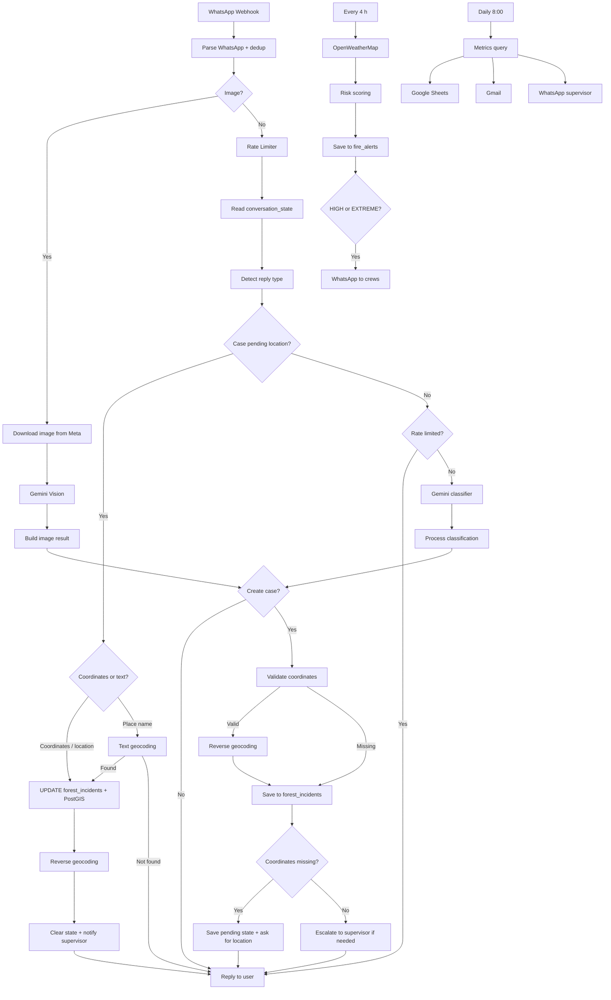
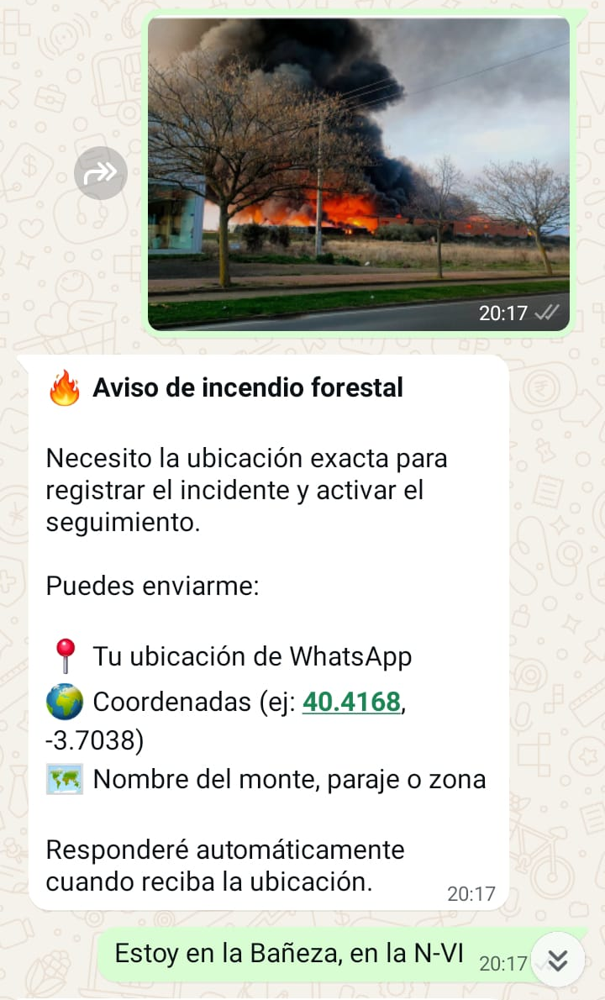

# 🔥 Wildfire Sentinel AI

🇪🇸 [Versión en español](README.ES.md)

**Wildfire Sentinel AI** is a multimodal wildfire reporting and alerting system built with **n8n**, **WhatsApp Business API**, **Gemini AI** (text and vision), **PostgreSQL/PostGIS**, **Google Maps Geocoding**, **OpenWeatherMap**, **Google Sheets** and **Gmail**.

Anyone can report smoke or fire over WhatsApp with a text, a photo or their location. The system classifies the report with AI, asks for the location if it is missing, stores a geolocated case and escalates critical cases to a supervisor. It also computes weather-based wildfire risk on a schedule and sends a daily metrics summary.

[](https://n8n.io/)
[](https://ai.google.dev)
[](https://developers.facebook.com/docs/whatsapp)
[](https://www.postgresql.org/)
[](https://postgis.net/)
[](https://mapsplatform.google.com/)
[](https://openweathermap.org/api)
[](LICENSE)
[](https://github.com/alejandro-orbis)

---

## 🚀 Key features

- 📲 WhatsApp intake: text, images, native location, documents and interactive buttons
- 🤖 Gemini report classification (`INCENDIO` / `OTRO`) with subtype and priority
- 🖼️ Image analysis with Gemini Vision: detects smoke, fire, estimated size and nearby houses or roads
- 📍 Pending-location conversation: if the location is missing, the bot asks for it and completes the case when it arrives
- 🗺️ Three ways to share a location: WhatsApp location, typed coordinates or a place name (text geocoding)
- 🧭 Reverse geocoding to municipality, province and approximate address
- 🗄️ Geospatial storage in PostgreSQL + PostGIS (`POINT`, SRID 4326)
- 🚨 Automatic supervisor escalation over WhatsApp based on type and priority
- 🌦️ Wildfire risk scoring every 4 hours with alerts to fire crews
- 📊 Daily metrics summary over WhatsApp, email and Google Sheets
- 🛡️ Per-conversation rate limiting and WhatsApp message deduplication

---

## 🧩 Workflows

| Workflow | Trigger | Purpose |
|---|---|---|
| `01 Core (WhatsApp)` | WhatsApp webhook | Intake, classification, geolocation, storage and escalation of reports |
| `02 Alertas (Clima)` | Every 4 hours | Weather risk scoring, storage and crew alerts |
| `03 Dashboard (Métricas)` | Daily at 8:00 | Last-7-days metrics to Google Sheets, Gmail and WhatsApp |

---

## 🏗️ Architecture



---

## 🧠 AI classification

### Text

Gemini classifies every message and returns JSON with type, subtype, priority, description, coordinates, text location and whether escalation is needed.

| Field | Values |
|---|---|
| `tipo` | `INCENDIO`, `OTRO` |
| `subtipo` | `HUMO`, `FUEGO`, `RAYO`, `COLILLA`, `QUEMA_ILEGAL`, `BARBACOA`, `MAQUINARIA`, `LINEA_ELECTRICA`, `FOCO_TERMICO`, `OTRO_RIESGO` |
| `prioridad` | `ALTA`, `MEDIA`, `BAJA` |

There are guardrails outside the AI: greetings and casual messages never create a case, and loose coordinates without a pending report don't either.

### Image

Photos are downloaded from the Meta API and sent to Gemini Vision, which estimates whether there is smoke or fire, the size of the fire and whether houses or roads are nearby. Priority is raised to `ALTA` when fire is visible, houses are nearby or the fire is large.

### Supervisor escalation

The supervisor is notified when the case is an `INCENDIO` with priority other than `BAJA`, or when priority is `ALTA`. They are also notified when a pending case receives its location.

---

## 🌦️ Weather risk scoring

The alerts workflow queries OpenWeatherMap every 4 hours and adds points for three factors:

| Factor | Threshold | Points |
|---|---|---|
| Temperature | > 25 / > 30 / > 35 °C | 15 / 30 / 40 |
| Humidity | < 40 / < 30 / < 20 % | 15 / 30 / 40 |
| Wind | > 20 / > 30 / > 50 km/h | 10 / 20 / 30 |

| Score | Level |
|---|---|
| ≥ 70 | `EXTREMO` |
| ≥ 50 | `ALTO` |
| ≥ 30 | `MODERADO` |
| < 30 | `BAJO` |

Every reading is stored in `fire_alerts`. At `ALTO` or `EXTREMO` level, a WhatsApp alert is sent to each configured crew member.

> The monitored zone is set by the coordinates in the **Consultar OpenWeatherMap** node. Change them to your area.

---

## 🛠️ Tech stack

| Technology | Use |
|---|---|
| n8n | Workflow orchestration |
| Gemini 2.5 Flash Lite | Text classification and image analysis |
| WhatsApp Business API (Meta Graph v19.0) | Report intake and notifications |
| PostgreSQL + PostGIS | Persistence and geospatial data |
| Google Maps Geocoding API | Text geocoding and reverse geocoding |
| OpenWeatherMap | Weather data |
| Google Sheets | Metrics history |
| Gmail | Email summary |

---

## 📂 Project structure

```text
Wildfire-Sentinel-AI/
├── README.md
├── README.ES.md
├── CHANGELOG.md
├── SECURITY.md
├── LICENSE
├── .env.example
├── workflows/
│   ├── Wildfire_Sentinel_AI_01_Core_WhatsApp.json
│   ├── Wildfire_Sentinel_AI_02_Alertas_Clima.json
│   └── Wildfire_Sentinel_AI_03_Dashboard_Metricas.json
├── database/
│   ├── schema.sql
│   ├── triggers.sql
│   └── indexes.sql
├── docs/
│   └── database.md
└── assets/
    └── screenshots/
```

---

## 🗄️ Main tables

| Table | Use |
|---|---|
| `forest_incidents` | Stored reports with coordinates, PostGIS point, priority, status and metadata |
| `conversation_state` | Cases waiting for a location, one per phone number |
| `fire_alerts` | Weather readings and computed risk level |

Case states in `forest_incidents.status`:

- `PENDIENTE_UBICACION`: stored, waiting for the user's location.
- `ABIERTO`: has a location, ready for follow-up.

See [docs/database.md](docs/database.md) for the full schema.

---

## 🖼️ Screenshots

| Architecture | Core workflow |
|---|---|
|  |  |

| Image analysis (Gemini Vision) |
|---|
|  |

| AI routing | Wildfire alert |
|---|---|
|  |  |

| Metrics workflow | Weather risk |
|---|---|
|  |  |

| Google Sheets | PostgreSQL |
|---|---|
|  |  |

---

## 🚀 Installation

### 1. Requirements

- Self-hosted n8n or n8n Cloud
- PostgreSQL 13+ with PostGIS (for example, Supabase)
- Meta for Developers app with WhatsApp Business API
- Google Cloud with Gemini API and Geocoding API enabled
- OpenWeatherMap account
- Google account with Sheets and Gmail

### 2. Set up the database

```sql
CREATE EXTENSION IF NOT EXISTS postgis;
```

```bash
psql -U postgres -f database/schema.sql
psql -U postgres -f database/triggers.sql
psql -U postgres -f database/indexes.sql
```

### 3. Import the workflows

In n8n: **Menu → Import from File** and import the three files in `workflows/`.

### 4. Configure credentials in n8n

| Credential | Nodes |
|---|---|
| Postgres | Reads and writes of cases, state, alerts and metrics |
| OpenWeatherMap | Consultar OpenWeatherMap |
| Google Sheets OAuth2 | Guardar en Google Sheets (histórico) |
| Gmail OAuth2 | Enviar email al supervisor |

In the Google Sheets node, select your own spreadsheet and sheet.

### 5. Configure the WhatsApp webhook

| Field | Value |
|---|---|
| Callback URL | `https://your-domain.com/webhook/omnichannel-webhook` |
| Verify Token | The value of `META_VERIFY_TOKEN` |
| Subscribed field | `messages` |

---

## 🔐 Environment variables

```env
N8N_BLOCK_ENV_ACCESS_IN_NODE=false
GEMINI_API_KEY=
META_ACCESS_TOKEN=
META_VERIFY_TOKEN=
WHATSAPP_PHONE_NUMBER_ID=
GOOGLE_MAPS_API_KEY=
SUPERVISOR_WHATSAPP=
SUPERVISOR_EMAIL=
BRIGADISTAS_WHATSAPP=["34600000000","34600000001"]
RATE_LIMIT_PER_MINUTE=15
```

- `N8N_BLOCK_ENV_ACCESS_IN_NODE=false` is required so the nodes can read `$env`.
- `BRIGADISTAS_WHATSAPP` must be a valid JSON array. If it is empty or malformed, the alerts workflow fails on purpose so the problem doesn't go unnoticed.
- OpenWeatherMap is configured as an n8n credential, not an environment variable.

---

## 📊 Metrics dashboard

Every day at 8:00, metrics for the last 7 days (plus the top locations for the last 30) are computed and sent to:

- Google Sheets, as a history row
- Gmail, as an HTML email to the supervisor
- WhatsApp, as a summary to the supervisor

Sheet columns:

```text
FECHA
INCIDENTES_TOTAL
INCIDENTES_ALTA
INCIDENTES_MEDIA
INCIDENTES_BAJA
INCENDIOS
INCIDENCIAS
ALERTAS_TOTAL
ALERTAS_EXTREMO
ALERTAS_ALTO
ALERTAS_MODERADO
ALERTAS_BAJO
TOP_UBICACIONES
INCIDENTES_POR_TIPO_JSON
ALERTAS_JSON
GENERADO_EN
```

---

## 🧪 Usage examples

### Text report without location

```text
User:       There's thick smoke right next to some houses.
Bot:        🔥 Wildfire report. I need the exact location...
User:       [sends WhatsApp location]
Bot:        ✅ Case completed with coordinates. ID: FOR-...
Supervisor: 📌 CASE UPDATED with location.
```

### Location by place name

```text
User: It smells like burning in the hills.
Bot:  I need the exact location...
User: Monte de Valdespartera, Zaragoza
Bot:  ✅ Case completed with coordinates.
```

### Photo report

```text
User: [sends a photo of a smoke column]
Bot:  I received the image and analysed it as a possible wildfire.
      I need the exact location...
```

> The bot replies in Spanish; the examples above are translated.

---

## 🛡️ Security

- Never commit `.env` files or credentials.
- Remove `pinData` from exported workflows before publishing: it can contain real phone numbers and request headers.
- Don't leave real phone numbers as default values in nodes.
- Keep rate limiting enabled.
- Protect the webhook verify token and, in production, validate Meta's `x-hub-signature-256` signature.
- Use Row Level Security if you make the system multi-organization.
- Rotate secrets before going to production.

---

## 🗺️ Roadmap

- Meta webhook signature validation
- Weather monitoring for multiple zones
- Duplicate report detection by geographic proximity
- Automatic assignment by zone
- Real-time web dashboard with GIS map
- Advanced case state management
- Voice note reports
- Automatic PDF reports
- Multichannel support: Telegram, Instagram and Messenger

---

## ⚠️ Disclaimer

This repository is a public demo version for educational and portfolio purposes. Some prompts and production components may be simplified.

This system **does not replace** official emergency services. In case of fire, always call **112** (or your local emergency number).

---

## 📄 License

MIT License.

---

## 👤 Author

**Alejandro Peralta**  
Process Automation Specialist · [Orbis Automations](https://orbisautomations.com)

- GitHub: [@alejandro-orbis](https://github.com/alejandro-orbis)
- LinkedIn: [linkedin.com/in/alejandro-orbis](https://linkedin.com/in/alejandro-orbis)
- Email: [Contact](mailto:alex_noya@hotmail.com)
